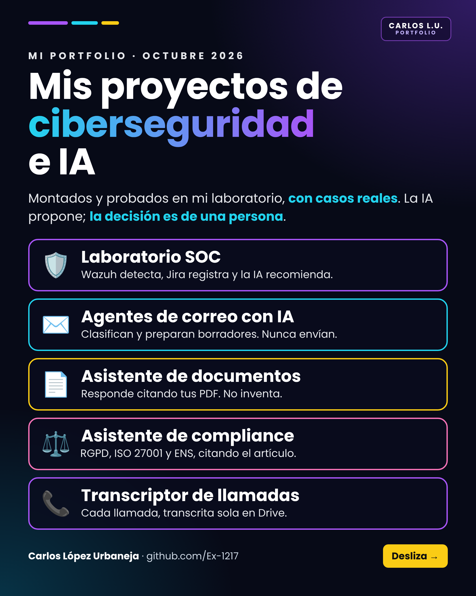
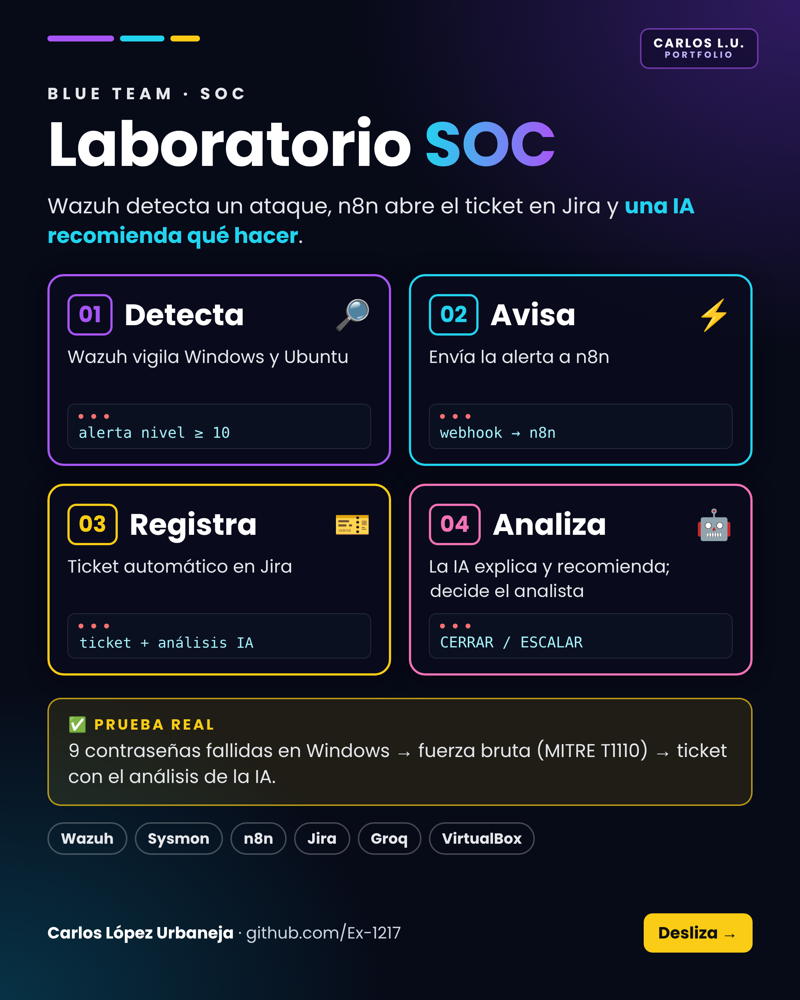
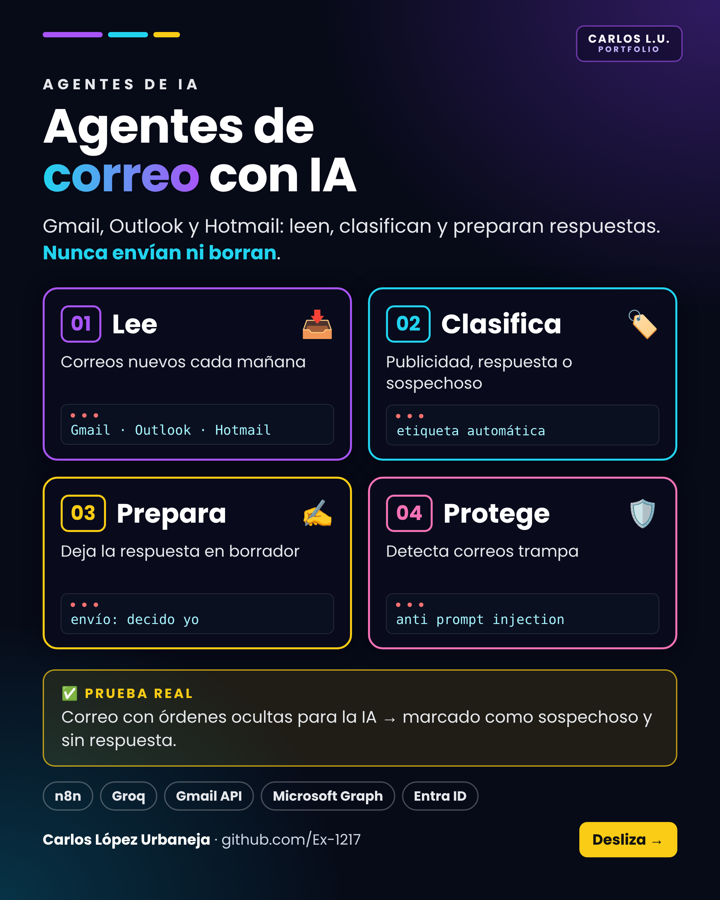
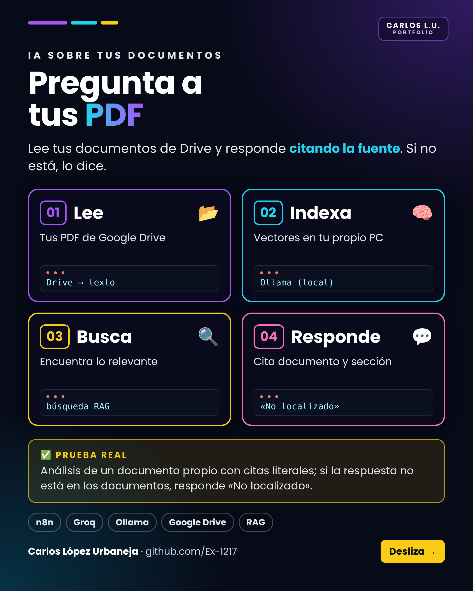
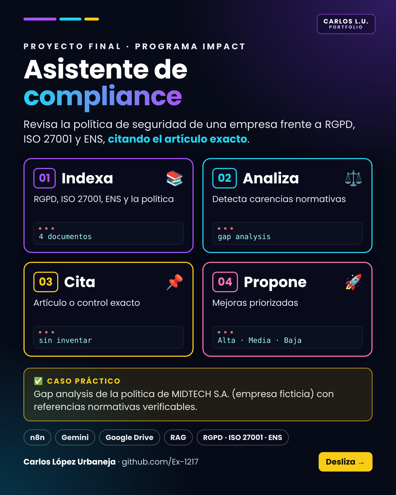
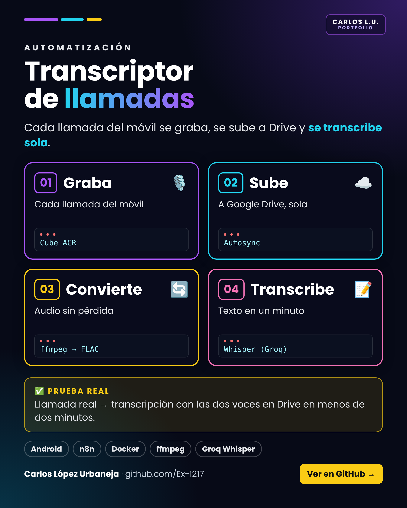

# Portfolio de Ciberseguridad — Carlos López Urbaneja

**Objetivo: mi primera oportunidad como Analista SOC Nivel 1 (Blue Team).**

Proyectos montados y probados de principio a fin en mi laboratorio: detección de ataques con un SIEM, triaje automático de alertas con tickets e IA, agentes de IA diseñados con criterios de seguridad y transcripción automática de llamadas. Cada proyecto se ha probado con un caso real y está documentado con una guía completa y una guía rápida.

📄 **[Portfolio completo en PDF](Portfolio_Carlos_Lopez_Urbaneja.pdf)**

---

## 🛡️ Laboratorio SOC: Wazuh + n8n + Jira con IA

Laboratorio en máquinas virtuales (red aislada) donde **Wazuh** vigila Windows 10 y Ubuntu, con una máquina vulnerable (Metasploitable) en la misma red. Las alertas graves (nivel ≥ 10) pasan a **n8n**, que abre un ticket en **Jira**; una **IA** lo analiza y recomienda cerrar o escalar. **La decisión final es del analista.**

**Prueba real:** 9 inicios de sesión fallidos en Windows → alerta 60204 (MITRE T1110, fuerza bruta) → ticket en Jira con el análisis de la IA como comentario.

**Herramientas:** VirtualBox · Kali Linux · Wazuh 4.14.8 · Windows 10 + Sysmon · Ubuntu · Metasploitable 2 · n8n (Docker) · Jira Cloud · Groq

Repositorio del proyecto: [wazuh-n8n-jira-soc-automation](https://github.com/Ex-1217/wazuh-n8n-jira-soc-automation)

---

## 📬 Agentes de correo con IA: Gmail, Outlook y Hotmail

Cada mañana revisan las tres cuentas, clasifican el correo nuevo (publicidad, requiere respuesta, sospechoso) y dejan las respuestas preparadas como borrador. **Nunca envían ni borran: decido yo.**

**Prueba real:** correo trampa con instrucciones ocultas para la IA → marcado como sospechoso y sin respuesta (defensa ante *prompt injection*).

**Herramientas:** n8n (Docker) · Groq (openai/gpt-oss-120b) · Gmail API (OAuth) · Microsoft Graph · app registrada en Entra ID

---

## 📄 Asistente personal: pregunta a tus PDF

Lee los documentos de una carpeta de Google Drive y responde en un chat citando el documento. Si la respuesta no está en los documentos, responde «No localizado»: **no inventa** (sistema RAG con control de alucinaciones). Los vectores se generan **en local** con Ollama.

**Herramientas:** n8n (Docker) · Google Drive · Groq · Ollama (nomic-embed-text) · Vector Store

---

## ⚖️ Asistente de compliance: RGPD, ISO 27001 y ENS

**Proyecto final del Programa IMPACT (Fundación GoodJob).** Revisa la política de seguridad de una empresa frente al RGPD, la ISO 27001:2022 y el ENS: detecta carencias, cita el artículo o control exacto y propone mejoras priorizadas.

**Caso práctico:** análisis de carencias de la política de MIDTECH S.A., empresa ficticia, con referencias normativas verificables.

**Herramientas:** n8n · Gemini · Google Drive · RAG

Repositorio del proyecto: [tfc-asistente-ciberseguridad-y-compliance](https://github.com/Ex-1217/tfc-asistente-ciberseguridad-y-compliance)

---

## 📞 Transcriptor automático de llamadas

Cada llamada del móvil se graba sola, se sube a Google Drive y **n8n** la convierte con **ffmpeg**, la transcribe con **Whisper** y guarda el texto junto al audio. Sin tocar nada.

**Prueba real:** llamada real del móvil → grabación con las dos voces → transcripción en Drive en menos de dos minutos.

**Herramientas:** Android · Cube ACR · Autosync · Google Drive · n8n (Docker) · ffmpeg · Groq Whisper

---

## 🎓 Formación

- **Fundación GoodJob · Programa IMPACT** (completado). Proyecto final: el asistente de compliance.
- **Itinerarios de especialización** (autoformación con seguimiento de la fundación): Analista SOC Junior (Blue Team), en curso, y Auditor de Accesibilidad, completado.

---

## 🧭 Cómo trabajo

- **Pruebo de principio a fin:** cada proyecto se da por terminado solo cuando funciona con un caso real.
- **Documento todo:** guía completa y guía rápida, con los problemas encontrados y su solución.
- **Seguridad desde el diseño:** red aislada, credenciales fuera de los flujos, mínimo privilegio y MFA.
- **La IA ayuda, yo decido:** la IA analiza y propone; las decisiones las toma una persona.

📫 [LinkedIn](https://www.linkedin.com/in/carlos-l-08b636154)
